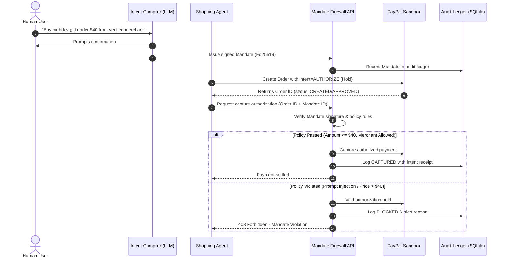

# Mandate: Autonomous AI Agent Spending Firewall for PayPal

> A deterministic spending firewall and cryptographic intent audit ledger for agentic commerce.

[](https://opensource.org/licenses/MIT)
[](https://nodejs.org/)
[](https://www.typescriptlang.org/)

---

## 1. Problem Statement
When an AI agent interacts with PayPal, the payment rails only verify that the API request originated from a valid user session or API token. PayPal cannot determine human intent (e.g., *"Spend at most $40 on a verified seller, arriving Friday"*). If an agent is tricked by prompt injection, compromised, or hallucinates, rogue transactions execute without verifiable intent boundaries to resolve disputes.

## 2. Solution: The Mandate Architecture
1. **Intent Compiler**: Human constraints are compiled into an Ed25519 cryptographically signed Mandate (price cap, allowed merchants, currency, expiry).
2. **Shopping Agent**: Prepares transactions on PayPal using `intent=AUTHORIZE` (placing funds on a temporary hold instead of immediate capture).
3. **Mandate Firewall API**: A deterministic policy engine written in strict code (not an LLM) validates the proposed payment against the signed mandate.
4. **Enforcement Service**: Holds capture credentials. If valid, it executes `CAPTURE`; if violated, it calls `VOID` immediately.
5. **Tamper-Evident Audit Ledger**: An append-only SQLite store with SHA-256 hash chaining powers an interactive AG Grid audit ledger.

---

## 3. Architecture Sequence Diagram



---

## 4. Team Responsibilities
* **Policy Engine & Intent Compiler**: Vinay, Harshit (`src/mockPolicy.ts` -> Production Ed25519 engine)
* **REST API, Database & PayPal Integration**: Siri (Fastify routes, SQLite hash-chained audit ledger, PayPal Orders v2 enforcement)
* **Frontend Audit Dashboard**: Kaif (React + AG Grid Community)

---

## 5. Getting Started

### Prerequisites
* Node.js >= 20.x
* npm >= 10.x

### Setup
```bash
# Clone the repository
git clone https://github.com/VinayKhandia/mandate.git
cd mandate

# Install dependencies
npm install

# Copy environment template
cp .env.example .env
```

### Run Server in Development Mode
```bash
npm run dev
```

### Type Checking & Testing
```bash
npx tsc --noEmit
npm test
```
